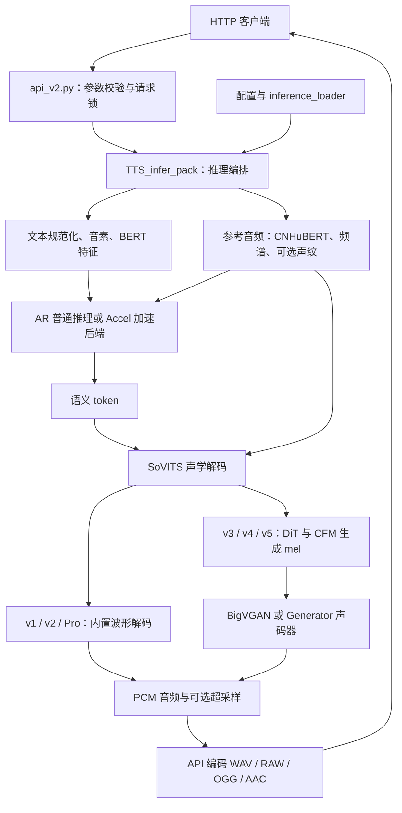

# 目录与架构

本仓库将 GPT-SoVITS 作为一个有状态的 HTTP 推理服务运行。一个进程加载一套当前模型与参考音频，通过 `api_v2.py` 接收合成和模型切换请求。安装与首次合成见 [README](../README.md)，接口契约见 [API 文档](api.md)。

## 目录职责

```text
GPT-SoVITS/
├── api_v2.py                 # 唯一服务入口、HTTP 参数与音频响应
├── GPT_SoVITS/               # 模型推理实现与默认资源路径
│   ├── TTS_infer_pack/       # 配置、文本预处理、推理编排、流式窗口
│   ├── AR/                   # GPT 文本到语义 token 推理
│   ├── Accel/                # 可选 CUDA Graph / Flash Attention AR 后端
│   ├── text/                 # 多语言规范化、音素、字典与 G2PW
│   ├── feature_extractor/    # CNHuBERT 参考音频特征
│   ├── module/               # SoVITS 解码、量化、CFM 与声码器组件
│   ├── f5_tts/               # CFM 使用的 DiT 网络
│   ├── BigVGAN/              # v3 声码器
│   ├── eres2net/             # Pro 系列说话人特征网络
│   ├── sv.py                 # 说话人特征提取入口
│   ├── inference_loader.py   # 权重加载和版本识别
│   ├── utils.py              # 旧检查点的 HParams 类型
│   ├── configs/              # 默认 tts_infer.yaml
│   └── pretrained_models/    # 本地基础权重，另行下载
├── tools/                    # 推理运行时、加速检测、超采样、日志翻译
├── tests/                    # API、流式、模型和文本回归测试
├── requirements.txt          # Windows/Linux 共用基础依赖
├── requirements/             # 指定平台的可选加速依赖
├── examples/                 # 可复制的 YAML 配置与 JSON 请求
├── docs/                     # 架构、模型、API 和部署说明
├── install.ps1 / install.sh  # 当前 Python 环境的依赖安装器
├── Dockerfile                # 推理镜像
├── docker-compose.yaml       # 单服务部署及资源挂载
└── .github/workflows/        # Windows/Linux 回归与容器检查
```

用户部署时还会创建 `.venv/`、`models/`、`references/` 和 `.codex/runtime-cache/`。它们分别保存隔离环境、角色权重、参考音频和运行缓存，不进入 Git。模型布局与各版本资源清单见 [模型指南](models.md)。

## 一次推理的处理链路



`TTS.py` 持有 GPT、SoVITS、BERT、CNHuBERT、声码器及参考音频缓存；`TextPreprocessor.py` 组织多语言文本处理。`AR/models/t2s_inference.py` 是纯 `nn.Module` 包装器，使用原检查点的 `model.*` 参数布局。版本识别和 SoVITS 权重读取由 `inference_loader.py` 负责。

v1、v2、v2Pro、v2ProPlus 使用 SoVITS 内置波形解码；v3 使用 24 kHz BigVGAN，v4、v5dev、v5turbo 使用 48 kHz `Generator` 声码器。`f5_tts/` 提供这些 CFM 路径实际使用的 DiT 网络。`tools/audio_sr.py` 调用 `AP_BWE_main/` 提供可选 24→48 kHz 超采样。

## 服务状态与流式生命周期

导入 `api_v2` 时，`tools/portable_runtime.py` 将工作目录切到仓库根目录，准备模块搜索路径、FFmpeg、Windows DLL 和语言资源路径。此时只读取配置，尚未加载 TTS 模型；FastAPI 的 `lifespan` 在服务启动时创建 TTS 实例，并在退出时关闭加速器。

`/tts` 与三个 `/set_*` 接口共用一把进程内异步锁。推理生成器在线程池中执行；流式响应持锁直到生成结束或客户端取消。取消时等待正在执行的工作完成，关闭生成器并释放锁，以免下一个请求与旧推理同时操作模型。

`/set_sovits_weights`、`/set_gpt_weights`、`/set_refer_audio` 修改当前进程的状态。更换角色时先暂停合成请求，再按 SoVITS、GPT、参考音频顺序切换；整套切换由多个 HTTP 请求组成，并非原子事务。多 worker 会各自持有独立模型和锁，因此部署示例使用单 worker。

普通流式按文本片段或窗口返回音频，相关窗口算法在 `TTS_infer_pack/streaming.py`。GPT 语义流式由 `Accel/` 增量生成 token，目前用于 v2ProPlus、v5dev、v5turbo，需要可用 CUDA 后端。普通推理可在加速器不可用时回退；GPT 语义流式有单独的设备与参数要求，详见 [API 流式说明](api.md)。

## 模块与资源边界

保留推理模块原名和默认模型布局，是为了让已有权重和配置继续工作：

- 旧检查点可能将配置保存为 `utils.HParams`；`GPT_SoVITS/utils.py` 提供该反序列化类型。
- 运行时把 `GPT_SoVITS/` 加入模块搜索路径，代码同时使用 `AR`、`module`、`text` 等短路径与 `GPT_SoVITS.*` 导入。语言模块和加速后端还存在动态导入。
- 网络参数名称和 AR 的 `model.*` 前缀属于检查点合约，修改它们需要相应的加载与数值回归证据。
- `pretrained_models/`、`text/G2PWModel/`、`tools/AP_BWE_main/24kto48k/` 有直接读取资源的代码；权重与源码分开提供，部署时按约定位置放置或挂载。
- `tools/i18n/` 服务于推理日志；`tools/portable_runtime.py` 和 `tools/acceleration.py` 服务于跨平台导入及后端选择，均属于运行依赖。

## 修改入口与验证

| 需求 | 主要修改位置 | 对应测试 |
| --- | --- | --- |
| HTTP 参数、响应、热切换、取消清理 | `api_v2.py` | `tests/test_api_v2_streaming.py` |
| 流式窗口和拼接 | `TTS_infer_pack/streaming.py` | `tests/test_official_streaming.py` |
| AR 推理、权重读取 | `AR/`、`inference_loader.py` | `tests/test_inference_runtime.py`、`tests/test_ar_g2pw_runtime.py` |
| SoVITS 与声码器 | `module/`、`f5_tts/`、`BigVGAN/` | `tests/test_sovits_inference.py`、`tests/test_inference_components.py` |
| 多语言处理和缓存 | `text/` | `tests/test_text_inference.py`、`tests/test_langdetect_cache.py` |
| 推理服务边界 | 入口与运行依赖 | `tests/test_inference_surface.py` |

在仓库根目录运行全部测试：

```bash
python -m unittest discover -s tests -t . -p "test_*.py"
```

仅验证 API 与流式算法：

```bash
python -m unittest tests.test_official_streaming tests.test_api_v2_streaming
```

测试使用小型检查点、受控输入或 mock pipeline 验证代码行为；多语言测试还需要相应语言资源。使用真实角色模型启动服务并调用 `/tts` 才能验证模型组合及实际语音输出。已验证平台与当前运行限制统一列在 [部署指南](deployment.md#limitations--known-issues) 和 [API 文档](api.md) 中。
