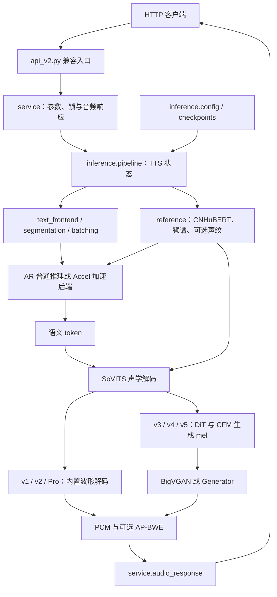

# 目录与架构

本仓库将 GPT-SoVITS 作为单进程、有状态的 HTTP 推理服务运行。`api_v2.py` 是稳定的启动命令和兼容导出层；实际 HTTP 服务位于 `GPT_SoVITS/service/`，推理编排位于 `GPT_SoVITS/inference/`。安装与首次合成见 [README](../README.md)，接口契约见 [API 文档](api.md)。

## 目录职责

```text
GPT-SoVITS/
├── api_v2.py                 # 兼容启动器；保持原 CLI 和常用导出
├── GPT_SoVITS/
│   ├── service/              # FastAPI 装配、路由、请求模型、编码与并发控制
│   ├── inference/            # 配置、模型生命周期、文本/参考处理与合成编排
│   ├── runtime/              # 项目路径、便携运行时初始化和日志本地化
│   ├── vendor/ap_bwe/        # AP-BWE 实现、许可证及规范资源位置
│   ├── Accel/                # 可选 CUDA Graph / FlashAttention AR 后端
│   ├── AR/                   # GPT 文本到语义 token 推理
│   ├── text/                 # 多语言规范化、音素、字典与 G2PW
│   ├── feature_extractor/    # CNHuBERT 参考音频特征
│   ├── module/               # SoVITS、量化、CFM 与声码器组件
│   ├── f5_tts/               # CFM 使用的 DiT 网络
│   ├── BigVGAN/              # v3 声码器
│   ├── eres2net/             # Pro 系列说话人特征网络
│   ├── configs/              # 默认 tts_infer.yaml
│   ├── pretrained_models/    # 本地基础权重，另行下载
│   └── utils.py              # 旧检查点的 HParams 反序列化类型
├── tools/                    # 旧导入/资源路径兼容层，不是新代码的规范入口
├── tests/                    # API、流式、模型和文本回归测试
├── requirements.txt          # Windows/Linux 共用基础依赖
├── requirements/             # 指定平台的可选加速依赖
├── examples/                 # 可复制的 YAML 配置与 JSON 请求
├── docs/                     # 架构、模型、API 和部署说明
├── install.ps1 / install.sh  # 当前 Python 环境的依赖安装器
├── Dockerfile                # 推理镜像，入口仍为 api_v2.py
└── docker-compose.yaml       # 单服务、单 worker 部署及资源挂载
```

`service/` 的主要边界如下：

- `app.py`：应用状态、FastAPI 装配和模型 lifespan。
- `routes.py` / `schemas.py`：`/tts`、三个热切换接口、请求默认值与规范化。
- `concurrency.py`：线程池调用、生成器迭代、取消清理和锁生命周期。
- `audio_response.py`：WAV、RAW、OGG、AAC 编码。
- `cli.py`：`-c/-a/-p` 参数和 `workers=1` 启动。

`inference/` 中，`pipeline.py` 组合有状态 `TTS`；`config.py` 处理版本与 YAML；`model_runtime.py` 负责 GPT、SoVITS、BERT、CNHuBERT、声码器和热切换；`reference.py` 管理参考缓存；`text_frontend.py`、`segmentation.py`、`batching.py` 处理文本；`synthesis.py`、`streaming.py` 执行普通和流式合成；`checkpoints.py`、`speaker.py`、`super_resolution.py` 分别承接旧加载器、声纹入口和 AP-BWE 适配职责。

用户部署时还会创建 `.venv/`、`models/`、`references/`、`.codex/runtime-cache/`，也可能提供顶层 `runtime/` 便携二进制包。它们分别保存隔离环境、角色权重、参考音频、可写缓存和可选 FFmpeg/DLL/语言资源，不进入 Git。模型布局见 [模型指南](models.md)。

## 一次推理的处理链路



v1、v2、v2Pro、v2ProPlus 使用 SoVITS 内置波形解码；v3 使用 24 kHz BigVGAN，v4、v5dev、v5turbo 使用 48 kHz `Generator` 声码器。`f5_tts/` 提供 CFM 路径使用的 DiT 网络。v3 可由 `inference/super_resolution.py` 调用 `vendor/ap_bwe/` 完成 24→48 kHz 超采样。

## 服务状态与流式生命周期

导入 `api_v2` 时，`service/app.py` 调用 `runtime/portable.py`，将工作目录切到仓库根目录并准备模块搜索路径、FFmpeg、Windows DLL 和语言资源路径。此时构造配置，但不加载 TTS 权重；FastAPI lifespan 在服务启动时创建一个 `TTS` 实例，并在退出时关闭加速器。

`/tts` 与三个 `/set_*` 接口共用一把进程内异步锁。同步推理生成器在线程池中执行；流式响应持锁直到生成结束或客户端取消，清理完成后才释放锁。模型和参考音频状态只属于当前进程，因此 CLI 和容器均固定单 worker。

普通流式及 GPT 语义流式实现位于 `inference/streaming.py`。GPT 语义流式目前用于 v2ProPlus、v5dev、v5turbo，需要可用 CUDA 后端；普通推理在加速不可用时回退。详细约束见 [API 流式说明](api.md)。

## 导入、检查点与资源兼容边界

新应用代码应使用 `GPT_SoVITS.service.*`、`GPT_SoVITS.inference.*`、`GPT_SoVITS.runtime.*` 和 `GPT_SoVITS.vendor.ap_bwe.*`。以下兼容边界仍有意保留：

- `api_v2.py` 继续导出 `APP`、`TTS`、`TTS_Config`、请求类型及旧可变状态名称，并保持原启动命令。
- `tools/portable_runtime.py`、`tools/acceleration.py`、`tools/audio_sr.py` 和 `tools/i18n/` 是旧导入兼容包装；`tools/AP_BWE_main/` 还保留旧部署资源位置。
- `runtime/paths.py` 优先读取 `GPT_SoVITS/vendor/ap_bwe/24kto48k/g_24kto48k.zip`，不存在时回退 `tools/AP_BWE_main/24kto48k/g_24kto48k.zip`，以兼容既有挂载。
- 旧检查点可能保存 `utils.HParams`；`GPT_SoVITS/utils.py` 必须留在原位。
- `AR/`、`module/`、`text/` 等短导入、网络参数名称和 AR 的 `model.*` 前缀属于检查点或动态导入合约，不应只为目录统一而改名。
- `pretrained_models/`、`text/G2PWModel/`、`vendor/ap_bwe/24kto48k/` 和 `runtime/i18n/locale/` 是运行资源路径；部署时按约定位置提供。

## 修改入口与验证

| 需求 | 主要修改位置 | 对应测试 |
| --- | --- | --- |
| HTTP 参数、响应、热切换、取消清理 | `GPT_SoVITS/service/`、`api_v2.py` | `tests/test_api_v2_streaming.py` |
| 流式窗口和拼接 | `GPT_SoVITS/inference/streaming.py` | `tests/test_official_streaming.py` |
| 配置、权重识别与模型生命周期 | `GPT_SoVITS/inference/config.py`、`checkpoints.py`、`model_runtime.py` | `tests/test_inference_runtime.py` |
| SoVITS、声码器、声纹与 AP-BWE | `module/`、`f5_tts/`、`BigVGAN/`、`inference/speaker.py`、`vendor/ap_bwe/` | `tests/test_sovits_inference.py`、`tests/test_inference_components.py` |
| 多语言处理和缓存 | `inference/text_frontend.py`、`text/`、`runtime/paths.py` | `tests/test_text_inference.py`、`tests/test_langdetect_cache.py` |
| 推理服务边界 | `service/`、`inference/`、`runtime/` 与兼容入口 | `tests/test_inference_surface.py` |

不加载模型权重的导入检查：

```bash
python -c "import api_v2; from GPT_SoVITS.service.app import APP; from GPT_SoVITS.inference import TTS, TTS_Config; assert api_v2.APP is APP and api_v2.tts_pipeline is None"
```

运行全部回归：

```bash
python -m unittest discover -s tests -t . -p "test_*.py"
```

仅验证 API、流式和结构边界：

```bash
python -m unittest tests.test_inference_surface tests.test_api_v2_streaming tests.test_official_streaming
```

测试使用小型检查点、受控输入或 mock pipeline；多语言测试还需要相应语言资源。真实权重启动和一次 `/tts` 请求仍是模型组合及实际语音输出的最终验证。已验证平台和限制见 [部署指南](deployment.md#limitations--known-issues) 与 [API 文档](api.md)。
